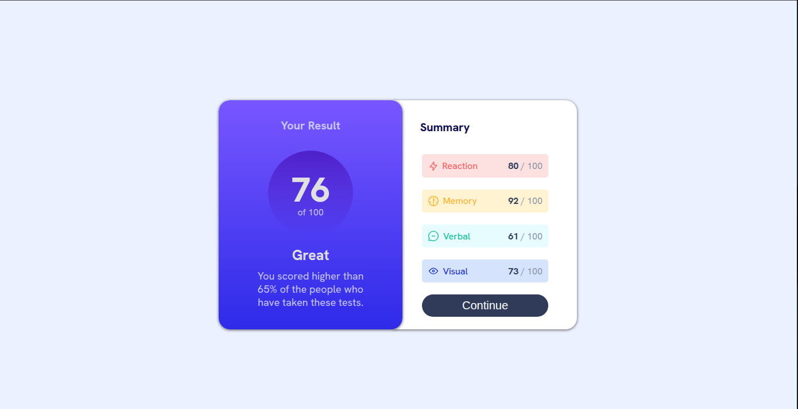
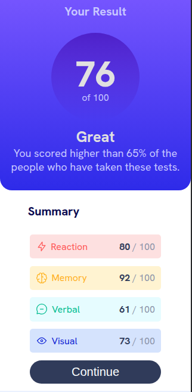

# Frontend Mentor - Results Summary Component Solution

This is a solution to the [Results summary component challenge on Frontend Mentor](https://www.frontendmentor.io/challenges/results-summary-component-CE_K6s0maV). Frontend Mentor challenges help you improve your coding skills by building realistic projects.

## Table of contents

- [Overview](#overview)
  - [The challenge](#the-challenge)
  - [Screenshot](#screenshot)
  - [Links](#links)
- [My process](#my-process)
  - [Built with](#built-with)
  - [What I learned](#what-i-learned)
  - [Continued development](#continued-development)
  - [Useful resources](#useful-resources)
  - [AI Collaboration](#ai-collaboration)
- [Author](#author)

## Overview

I built a responsive results summary component using HTML and CSS. I am especially proud that I got the two cards to sit side by side on larger screens and on smaller screens.

### The challenge

The challenge was to recreate a responsive summary component where users will be able to:

- View the optimal layout for the interface depending on their device's screen size
- See hover and focus states for all interactive elements on the page.

### Screenshot

### Links

- Solution URL: [Add solution URL here](https://your-solution-url.com)
- Live Site URL: [Add live site URL here](https://your-live-site-url.com)

## My process

I began by breaking the design into two main sections and they are, the results panel and the summary panel. I used Flexbox to place them side by side on wider screens, then added a media query to stack them on smaller screens. I used the style guide to choose the colors and typography and added hover and keyboard-focus styles to the button.

### Built with

- Semantic HTML5 markup
- CSS3
- Flexbox
- Responsive layout

### What I learned

I learned how rem units compare with pixels. Using rem for spacing and element sizes can make a layout scale more easily when the root font size changes, while pixels are useful when I need a fixed size. I would like to keep practicing when to choose each unit.

### Continued development

In future projects, I would like to practice deciding when CSS Grid is a better fit than Flexbox. I also want to keep improving my responsive design skills by testing layouts across a wider range of screen sizes.

I would like to learn how to use CSS custom properties for reusable values, such as colors and spacing, so styles are easier to maintain and update.

I would also like to start learning JavaScript so I can add interactive features to future projects.

### AI Collaboration

I used GitHub Copilot to review my code and check whether there were any errors after I finished. I also asked Claude questions to better understand when to use rem instead of px and to compare different implementation options. I used both tools as tutors to clarify concepts and help me make decisions, rather than simply generate code.

## Author

- Website - [Godson](https://www.your-site.com)
- Frontend Mentor - [@Godson142](https://www.frontendmentor.io/profile/Godson142)
